# Mint Rush 🍁

**A provably fair crash game themed on Canadian banknote security printing.**
Built for the ThunderHacks 2026 Canadian Bank Note sponsor challenge.

Place a wager and three paper sky lanterns lift off over an engraved guilloché backdrop. The multiplier is painted on the big one. The lanterns float higher and glow brighter gold as it climbs, flash green when you cash out, and turn red and drop when it crashes. Cash out in time to win wager × multiplier. If it crashes first, the stamp reads **CRASHED** and the wager is lost.

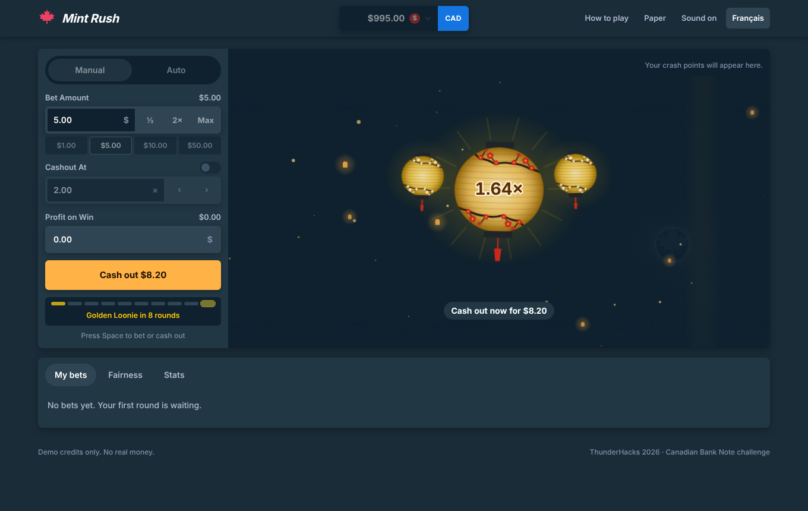

| Cashed out | Crashed | Autobet |
|---|---|---|
| 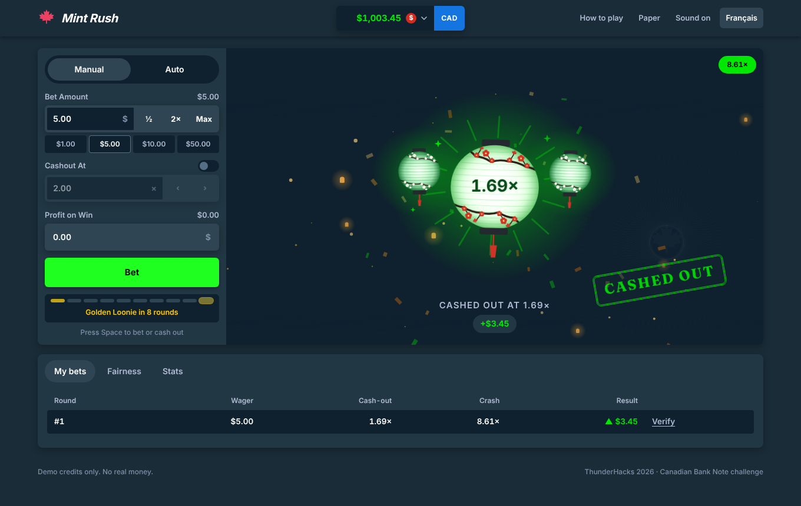 | 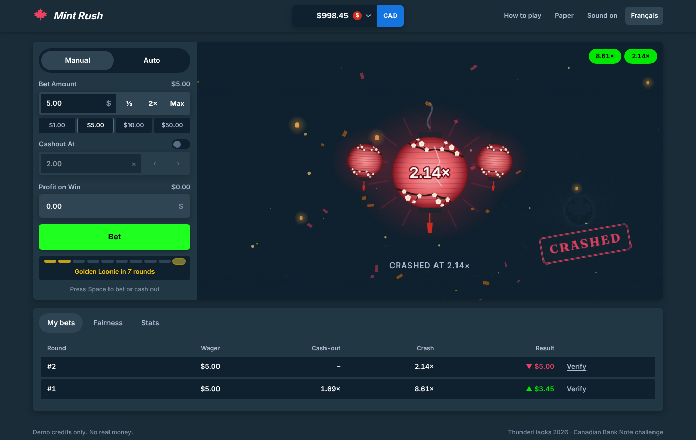 | 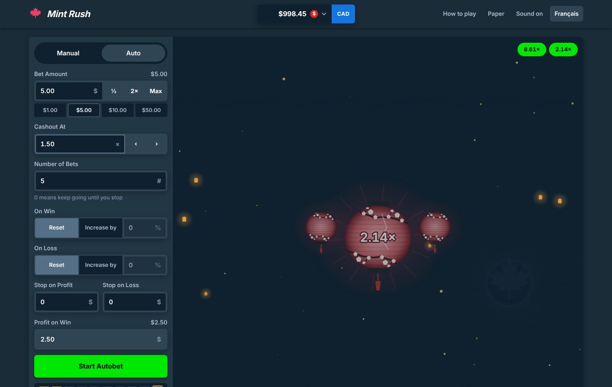 |

| Currencies | Verified in the browser | Stats and house check |
|---|---|---|
| 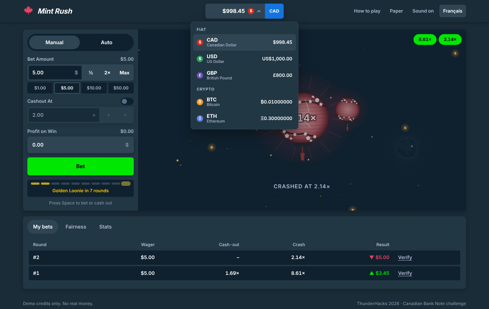 | 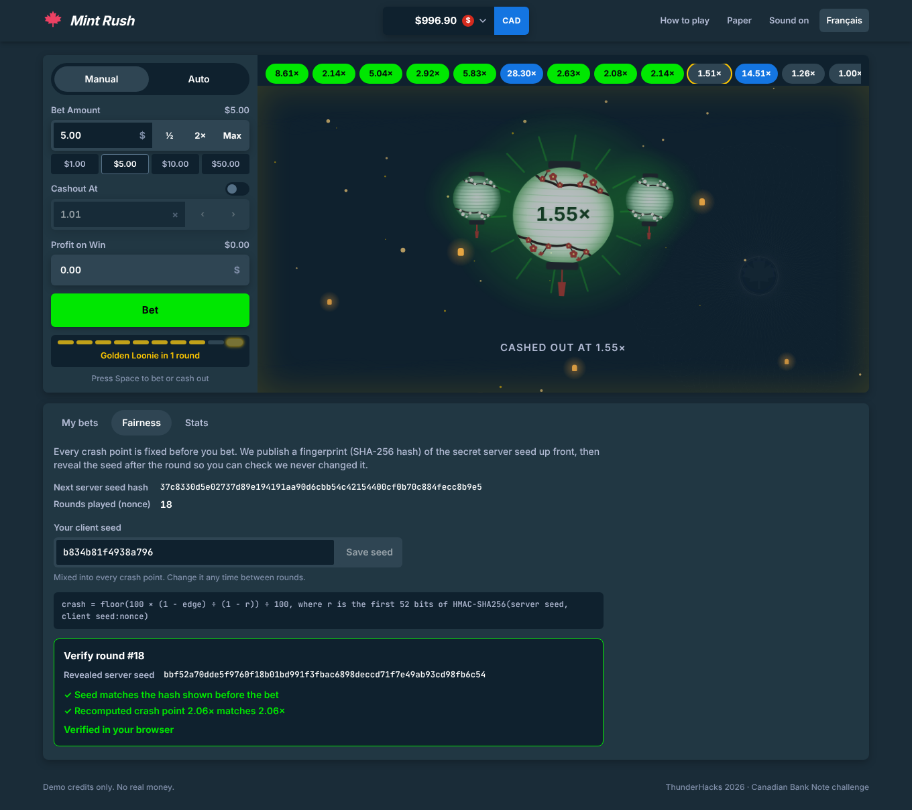 | 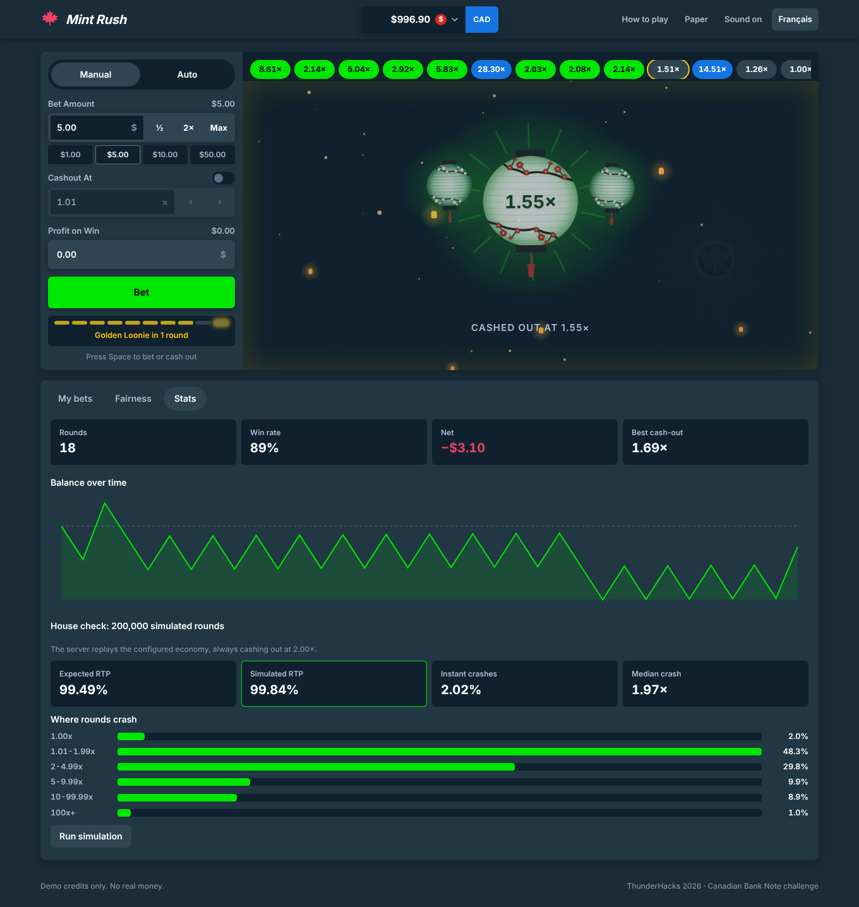 |

| Golden Loonie round | Français | Mobile |
|---|---|---|
| 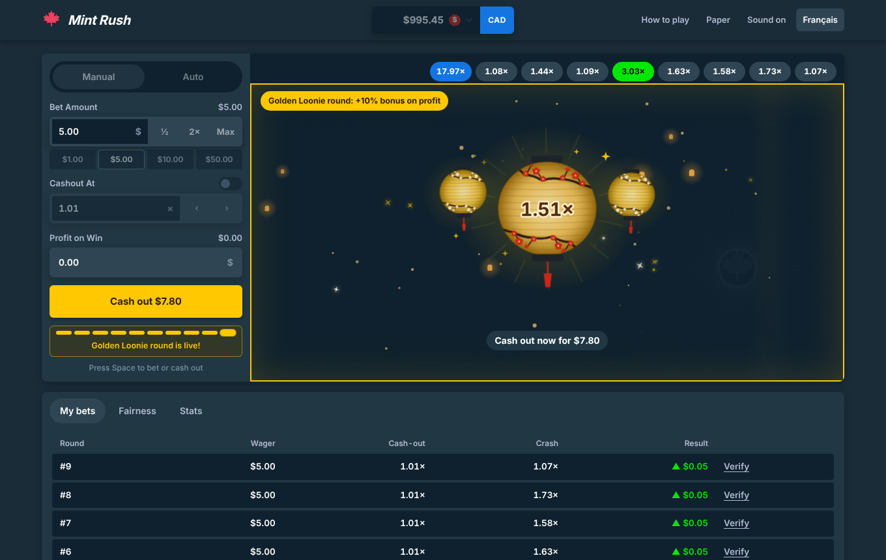 | 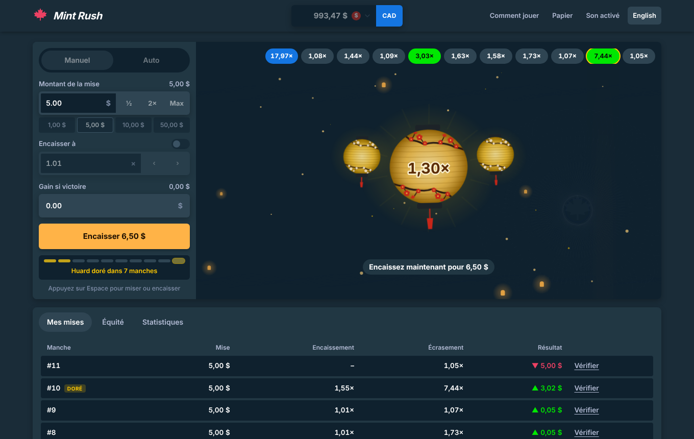 | 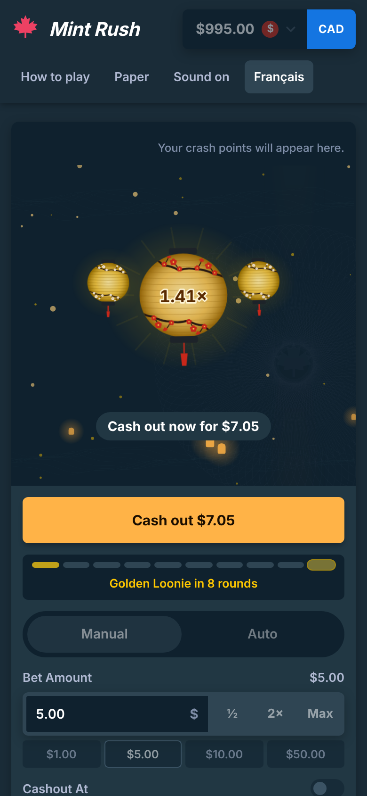 |

## Quick start

Requires Node 22.13 or newer. There are no native modules: storage uses Node's built-in SQLite.

```bash
npm install
npm run dev        # server on :8787, web on http://localhost:5173
```

To run in production on one port:

```bash
npm run build && npm start      # http://localhost:8787
# or
docker build -t mint-rush . && docker run -p 8787:8787 -v mint-data:/data mint-rush
```

To build a static, server-less demo (the game service runs inside the page, for hosting on any static site):

```bash
npm run build:demo               # apps/web/dist-demo
```

Other commands:

```bash
npm test                         # 54 tests: engine, economy, API on both stores
npm run typecheck
npm run simulate -- 1000000 2    # long-run economics of the current config
```

## What's in it

**MVP requirements**
- Bet and Cash out controls in a casino-style sidebar, with keyboard support (Space).
- Balance, wager, and a live multiplier with a potential-payout readout.
- Server-side account balance with a full ledger.
- A random crash point between 1.00x and the configured maximum, settled by the server.

**Optional enhancements built**
- Auto cash-out ("Cashout At") with a live "Profit on Win" preview.
- Autobet mode: number of bets, increase or reset the wager on a win or loss, and stop on a profit or loss limit.
- Five wallets: Canadian dollar, US dollar, British pound, Bitcoin and Ethereum. Each has its own balance, bet limits, presets and stats, and crypto amounts show all 8 decimals. Pick one from the wallet menu in the top bar.
- Configurable bets: presets, ½ / 2× / Max, min/max limits.
- Session history and a "My bets" table.
- Golden Loonie bonus rounds: every 10th round boosts profit by 10%.
- Stats tab with a balance chart and a live RTP simulation.
- Accessibility: screen-reader announcements, reduced-motion support, focus styles and forced-colors support.
- Full English and French localization.
- Two visual themes: Night (dark slate with a green bet button, the default) and Paper (light, engraved).
- Synthesized sound effects.
- **Provably fair** rounds that any player can verify in their own browser.

**Look and feel**
- Sky lanterns instead of a graph: gold while rising, green on a cash-out, red on a crash. Embers and far-off lanterns stream past faster as the multiplier grows.
- The multiplier starts slow and keeps speeding up, so long rounds feel like a rush.
- Golden Loonie rounds: a meter counts down to them, the next one gets a shining Bet button, and wins rain gold coins and sparkles.
- Rounds end with a CASHED OUT or CRASHED stamp.
- On phones, the Bet button sits right under the game with the settings below it.

## Architecture

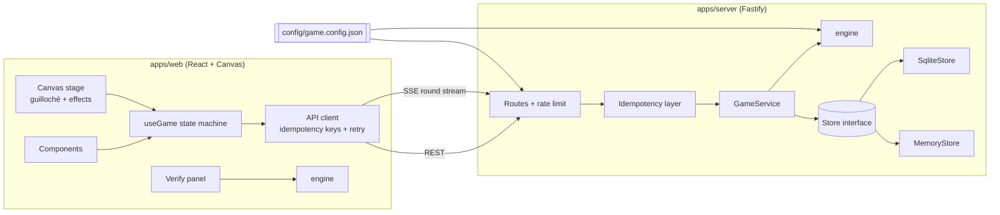

```
config/game.config.json   every gameplay rule in one validated file
packages/engine           pure TypeScript: RNG, curve, settlement, payouts, simulation (no I/O)
apps/server               Fastify API, GameService, idempotency, Store adapters
apps/web                  React UI, canvas stage, i18n catalogs, themes
```

### Design decisions

- **The server is the authority, the client is a renderer.** The client never learns the crash point while a round is running. The multiplier is a pure function of time (`m(t) = e^(rate·t + acceleration·t²)`, so the climb keeps speeding up), so the client animates locally from a synced clock. The server pushes the exact settlement moment over Server-Sent Events.
- **The engine is pure.** Settlement takes `(round, time, config)` and returns an outcome. There are no clocks, randomness or I/O, so every rule is unit-tested. The server and the browser verifier import the *same* code.
- **Money is integers.** All amounts are minor units (cents) and multipliers are integer hundredths. Payouts always round down, so floating-point error never touches a balance.
- **Server idempotence.** `POST /api/bets` and `POST /api/rounds/:id/cashout` require an `Idempotency-Key`. Retries replay the stored response, and concurrent duplicates share one execution. The client retries network failures with the same key, so a double-click or a flaky connection can never double-charge.
- **Lazy plus scheduled settlement.** A timer settles each round at its crash or auto-cash-out moment. Any read also settles a round that is overdue, and running rounds are re-armed after a restart. No round is ever stuck.
- **Pluggable storage.** `GameService` only knows the `Store` interface. SQLite (durable, transactional) and in-memory adapters ship. The whole API test suite runs against both.

## Provably fair RNG

1. Before you bet, the server shows `SHA-256(serverSeed)` for your next round.
2. The crash point is `HMAC-SHA256(serverSeed, "clientSeed:nonce")`. You can change your client seed at any time between rounds.
3. The first 52 bits give a uniform `r ∈ [0,1)`, and `crash = floor(100 × (1 − edge) / (1 − r)) / 100`, clamped to `[1.00, max]`.
4. After the round, the seed is revealed. The **Verify** button recomputes both the hash and the crash point in your browser with Web Crypto.

**Why the maths is fair:** for any target `t`, `P(crash ≥ t) = (1 − edge) / t`. Every cash-out strategy therefore has the same expected return, `RTP = 1 − edge` (99% by default). Golden rounds add `(1/N) × boost × (t−1)/t` on top. The Stats tab runs a fresh simulation on the server to show this, and `test/economy.test.ts` asserts it.

## Configuration

Everything is in [`config/game.config.json`](config/game.config.json). It is validated with zod at startup, and a bad value produces a readable error. The UI reads the same config from `GET /api/config`.

| Key | Default | Effect |
|---|---|---|
| `rng.houseEdge` | `0.01` | RTP = 1 − edge |
| `rng.maxMultiplier` | `1000` | Highest possible crash point |
| `timing.growthRatePerSecond` | `0.08` | Starting speed of the multiplier |
| `timing.accelerationPerSecond2` | `0.003` | How fast the climb speeds up (2x at ≈6.9 s, 10x at ≈17 s) |
| `currencies[]` | CAD, USD, GBP, BTC, ETH | One wallet each, with `symbol`, `kind` (fiat or crypto), `minorUnits`, `startingBalance`, `topUpAmount`, `minBet`, `maxBet` and `presets`. Amounts are in the smallest unit (cents, pence, satoshis). The first entry is the default. |
| `betting.minAutoCashOut` | `1.01` | Lowest auto target |
| `bonus.goldenRoundEvery` / `goldenMultiplierBoost` | `10` / `0.1` | Golden Loonie rounds |
| `ui.locales` / `defaultLocale` / `theme` | `en, fr` / `en` / `night` | Presentation |

Environment variables: `PORT`, `STORE=memory|sqlite`, `DB_PATH`, `CONFIG_PATH`, `STATIC_DIR`.

**To add a language,** add `apps/web/src/i18n/<code>.ts` typed as `Record<MessageKey, string>`. The compiler then rejects any missing string. Register the file in `i18n/index.tsx` and list the code in `ui.locales`.

## API

| Method | Path | Notes |
|---|---|---|
| `POST` | `/api/session` | Creates a guest account and returns a bearer token |
| `GET` | `/api/me` | Balance, seeds, active round, server time |
| `POST` | `/api/bets` | `{ wager, autoCashOut?, currency? }`, requires `Idempotency-Key` |
| `POST` | `/api/rounds/:id/cashout` | Requires `Idempotency-Key` |
| `GET` | `/api/rounds/:id/stream` | SSE: `round`, then `settled` |
| `GET` | `/api/rounds/:id`, `/api/history` | Seeds are revealed only after settlement |
| `GET` | `/api/stats?currency=BTC` | Lifetime numbers for one wallet |
| `PUT` | `/api/seed` | `{ clientSeed }`, between rounds only |
| `POST` | `/api/topup` | `{ currency? }`, only when that wallet is below its minimum bet |
| `GET` | `/api/simulate?target=2&rounds=200000` | Monte Carlo house check |
| `GET` | `/api/config`, `/api/health` | |

Errors always look like `{ "error": { "code": "INSUFFICIENT_FUNDS", "message": "…" } }`. The UI translates the stable `code`.

## Demo script (2 minutes)

The full spoken pitch, a rubric map and answers to likely judge questions are in [PITCH.md](PITCH.md).

1. **Play:** bet $5 and cash out around 1.5x. Point out the payout readout, the green lanterns and the CASHED OUT stamp; the bets table shows where it would have crashed.
2. **Lose one:** let a round run until CRASHED appears.
3. **Fairness:** open My bets, press Verify, and show both checks passing in the browser.
4. **Idempotence:** run `npm test` and show the "retrying a bet with the same key does not double charge" test.
5. **Autobet:** switch to Auto, set 5 bets at 1.50×, and start it.
6. **Bilingual and themes:** press Français, then Paper.
7. **Economy:** open Stats. The simulated RTP sits on the expected RTP. Change `houseEdge` to `0.05`, restart, and show that it follows.

---

Demo credits only. No real money is involved.
